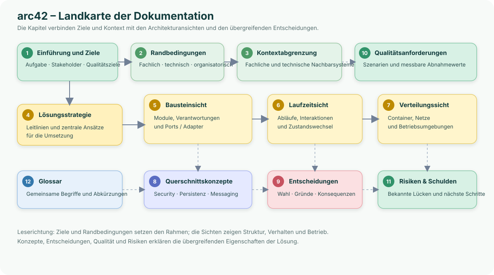
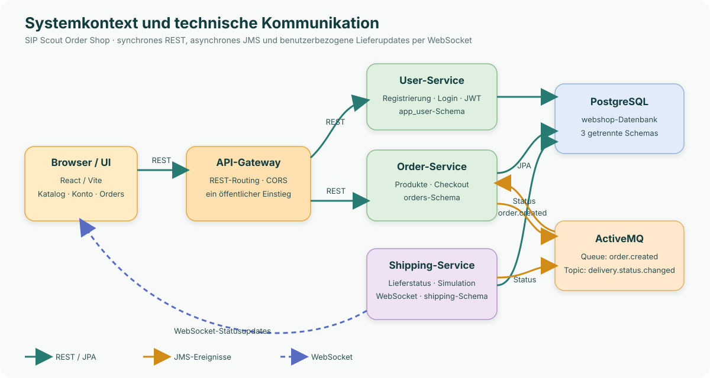
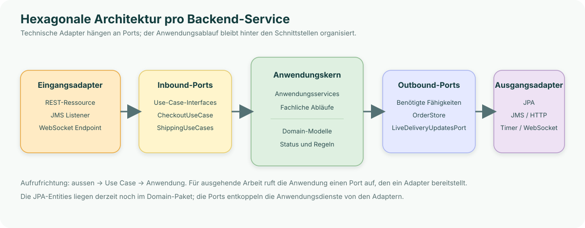
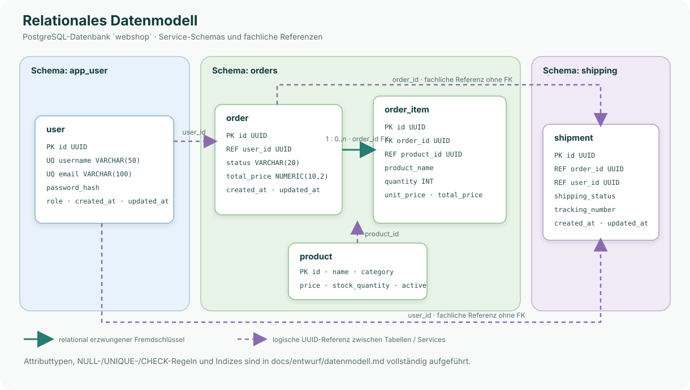
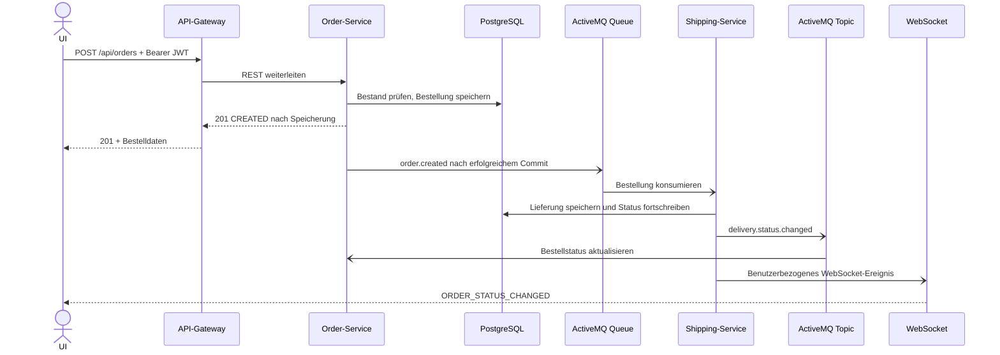
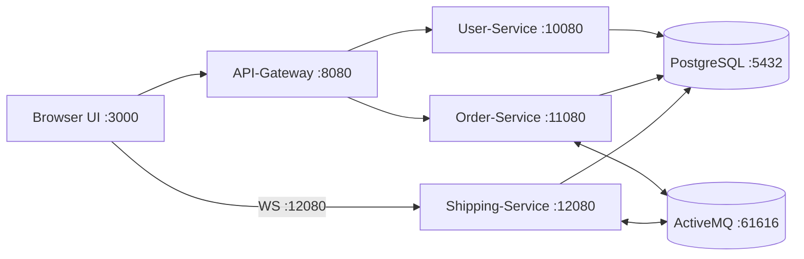
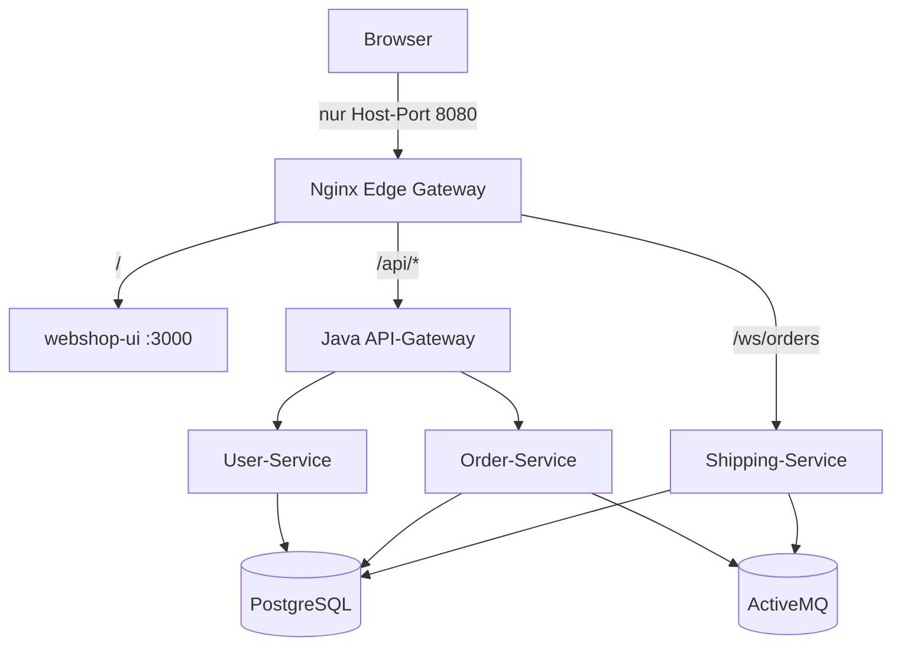

# SIP Scout Order Shop – arc42 Architekturdokumentation

**Stand:** 22.11.2026  
**System:** JEE Drink Shop / SIP Scout Order Shop  
**Statushinweis:** Diese Dokumentation beschreibt den aktuellen Repository-Stand. Ziele und Risiken sind als solche gekennzeichnet; sie behauptet keine nicht ausgeführten Tests oder Produktivfreigaben.

Die fachliche Vision, Anforderungen, Use Cases und SMART-Qualitätsziele sind separat unter [docs/spezifikation](spezifikation/README.md) beschrieben.



*Abbildung 1: Wie die arc42-Kapitel Ziele, Kontext, Architekturansichten und Querschnittsthemen verbinden.*

## 1. Einführung und Ziele

### 1.1 Aufgabenstellung

Die Anwendung bildet einen webbasierten Getränkeshop ab. Benutzer registrieren sich und melden sich an, sehen den Produktkatalog und erstellen Bestellungen. Nach erfolgreichem Speichern wird eine Lieferung asynchron ausgelöst. Der Lieferstatus wird gespeichert und während einer offenen UI-Sitzung per WebSocket übertragen.

### 1.2 Qualitätsziele

| Rang | Qualitätsziel | Konkretisierung |
|---|---|---|
| 1 | Funktionale Korrektheit | Eine Bestellung wird erst nach erfolgreicher Backend-Antwort als erstellt angezeigt; Besitzprüfungen begrenzen Bestellungen und Lieferdaten auf den angemeldeten Benutzer. |
| 2 | Änderbarkeit | Vier unabhängig deploybare Jakarta-EE-Module strukturieren Anwendungsfälle hinter Ports; technische Zugriffe liegen in Adaptern. |
| 3 | Verständliche Interaktion | REST eignet sich für synchrone Abfragen und Befehle; JMS entkoppelt Bestell- und Lieferablauf; WebSocket überträgt laufende Lieferänderungen. |
| 4 | Lokal reproduzierbarer Betrieb | PostgreSQL und ActiveMQ laufen lokal in Compose; Services können einzeln in IntelliJ gestartet werden. Ein zweites Compose-Setup startet UI und Backend gemeinsam. |
| 5 | Zugriffsschutz und Isolation | Browser-REST geht über das Gateway. Im Produktions-Compose veröffentlicht nur der Edge-Gateway einen Host-Port. Services prüfen geschützte Operationen anhand des JWT bzw. der User-Service-Identität. |

### 1.3 Stakeholder

| Rolle | Interesse |
|---|---|
| Shop-Benutzer | Registrieren, Getränke ansehen, bestellen, eigenen Bestell- und Lieferstatus verfolgen |
| UI-Entwicklung | Stabiler REST-Vertrag und Live-Updates über WebSocket |
| Entwicklerteam | Services lokal debuggen, Integrationen demonstrieren und Architektur weiterentwickeln |
| Dozierende / Prüfende | Jakarta-EE-Komponenten, Architekturentscheidungen, lauffähige Demo und nachvollziehbare Validierung beurteilen |

### 1.4 Umfang

Enthalten sind UI, API-Gateway, User-, Order- und Shipping-Service sowie PostgreSQL und ActiveMQ. Externe Zahlungsabwicklung, reale Logistik, E-Mail-Versand und produktiver Betrieb ausserhalb des lokalen Demo-Setups gehören nicht zum aktuellen Umfang.

## 2. Randbedingungen

### 2.1 Fachliche und organisatorische Randbedingungen

- Semesterarbeit im Modul Java Enterprise Edition; die Modulziele umfassen Jakarta-EE-Umgebung, Business-Komponenten, Datenhaltung und UI.
- Für die Präsentation sind rund 10 Minuten für Lösung und Demo sowie 10 Minuten für ein fachliches Vertiefungsthema vorgesehen.
- Die eingereichten Bewertungskriterien gewichten Spezifikation, Entwurf, Programmierung, Validierung und Präsentation. Die Dokumentation soll SMARTe Qualitätsanforderungen, mehrere Architektursichten, Datenmodell, Abnahmekriterien und dokumentierte Testergebnisse enthalten.

### 2.2 Technische Randbedingungen

| Thema | Festlegung im Projekt |
|---|---|
| Backend-Sprache | Java 21 Quell-/Zielversion im Maven-Build |
| Backend-Framework | Jakarta EE APIs; Docker-Images verwenden Payara Micro 6.2024.6, lokale IntelliJ-Konfigurationen GlassFish 8.x |
| Persistenz | JPA/EclipseLink und PostgreSQL 16 |
| Messaging | Jakarta JMS API mit Apache ActiveMQ Classic als Broker |
| UI | React/Vite-Anwendung im Ordner `webshop-ui`, lokaler Entwicklungsport 3000 |
| Build | Maven Multi-Module plus npm für die UI |
| Deployment | Docker Compose; produktionsähnliches Setup veröffentlicht extern nur Port 8080 am Nginx-Edge-Gateway |

### 2.3 Architekturvorgaben

- Service-übergreifende synchrone REST-Aufrufe laufen im Browserpfad über das API-Gateway; direkte Service-Ports dienen lokalem Debugging und interner Kommunikation.
- Der Shipping-Service ist der WebSocket-Endpunkt für Lieferstatusmeldungen. Im vollständigen Docker-Setup leitet der Edge-Gateway `/ws/orders` dorthin weiter.
- Services besitzen getrennte PostgreSQL-Schemas (`app_user`, `orders`, `shipping`). Sie verwenden dieselbe PostgreSQL-Instanz und Datenbank `webshop`, aber keine serviceübergreifenden Datenbank-Fremdschlüssel.
- Die fachliche Abhängigkeit der Module zeigt zu Ports bzw. Use Cases. Framework- und Infrastrukturdetails bleiben in Adaptern; JPA-Annotationen liegen derzeit noch auf den Domain-Modellen.

## 3. Kontextabgrenzung

### 3.1 Fachlicher Kontext



*Abbildung 2: Systemkontext und Kommunikationswege. Der WebSocket endet im Shipping-Service; der Nginx-Edge transportiert ihn im Docker-Betrieb.*

**Legende:** Durchgezogene REST-Pfeile sind synchrone HTTP-Aufrufe. JMS-Pfeile sind asynchron. Der Browser-WebSocket endet logisch im Shipping-Service; im Docker-Setup transportiert Nginx den Upgrade-Request.

### 3.2 Technischer Kontext und Schnittstellen

| Schnittstelle | Pfad / Protokoll | Verantwortung |
|---|---|---|
| UI → Gateway | HTTP REST, Docker `:8080/api/*`; lokal `:8080/api-gateway-1.0.0/api/*` | öffentlicher REST-Einstieg, CORS und Routing |
| Gateway → User-Service | HTTP REST | Registrierung, Login, Profil und Konto löschen |
| Gateway → Order-Service | HTTP REST | Produktabfrage und Bestelloperationen |
| Order → Shipping | JMS Queue `order.created` | neu bestätigte Bestellung an Lieferablauf übergeben |
| Shipping → Order | JMS Topic `delivery.status.changed` | Lieferstatus in Bestellung spiegeln |
| UI → Shipping | WebSocket `/ws/orders` | Benutzerbezogene Live-Statusmeldungen |
| Services → PostgreSQL | JDBC/JPA | je Service eigenes Schema |
| Services → ActiveMQ | JMS/OpenWire | asynchrone Geschäftsereignisse |

## 4. Lösungsstrategie

1. **Service-Aufteilung nach Verantwortung:** Konto und Identität, Produkt/Bestellung, Lieferung und REST-Einstieg sind getrennte Maven-Module.
2. **Ports und Adapter:** Eingänge (REST/JMS/WebSocket) rufen Anwendungs-Ports auf. Anwendungsdienste nutzen Ausgangs-Ports für Datenhaltung, Token-/Passwortfunktionen, Service-Identität, Messaging, Timer und Live-Updates.
3. **Synchron für direkte Antworten:** Konto-, Produkt- und Bestell-REST-Aufrufe liefern unmittelbar HTTP-Antworten. Der Gateway-HTTP-Adapter leitet Status, Header und Nutzdaten weiter.
4. **Asynchron für Lieferung:** Der Order-Service veröffentlicht nach erfolgreichem Commit ein Bestellereignis. Der Shipping-Service erzeugt eine Lieferung und simuliert deren Zustellung verzögert.
5. **Persistenter Status plus Live-Kanal:** Die Datenbank bleibt Quelle des aktuellen Zustands. WebSocket beschleunigt UI-Updates; beim erneuten Laden liest die UI den Stand erneut per REST.
6. **Zwei Betriebsarten:** lokal Services im IntelliJ-Debugger und Infrastruktur in Docker; vollständig containerisiert mit dem `prod` Maven-Profil und `docker-compose.prod.yml`.

## 5. Bausteinsicht

### 5.1 Gesamtbausteine

| Baustein | Aufgabe | Eingänge | Ausgänge / Daten |
|---|---|---|---|
| `webshop-ui` | Registrierung, Login, Katalog, Bestellungen und Live-Status | Benutzerinteraktion, REST-/WebSocket-Antworten | REST ans Gateway, WebSocket-Verbindung |
| `api-gateway` | REST-Routen, CORS, Weiterleitung an Backend-Services | JAX-RS Ressourcen | HTTP-Client-Aufrufe zu User und Order |
| `user-service` | Benutzerkonto, Passwortprüfung, JWT-Erzeugung und Profil | REST | User-Schema, Token- und Passwort-Ports |
| `order-service` | Produktkatalog, Checkout, eigene Bestellungen, Statusübernahme | REST und JMS | Order-/Produkt-Schema, `order.created` |
| `shipping-service` | Lieferung anlegen, Status simulieren, WebSocket senden | JMS, REST, WebSocket | Shipping-Schema, JMS-Topic, Timer, WebSocket |
| PostgreSQL | dauerhafte Nutzerdaten, Produkte, Bestellungen und Lieferungen | JDBC/JPA | drei fachlich getrennte Schemas |
| ActiveMQ | asynchrone Zustellung der Domain-Ereignisse | JMS Producer | Queue und Topic |

### 5.2 Hexagonaler Aufbau je Backend-Service

```text
adapter/in  -> application/port/in -> application/service -> application/port/out <- adapter/out
```

Die Pfeile zeigen Aufruf- bzw. Abhängigkeitsrichtung. Inbound-Adapter übersetzen externe Nachrichten in Use-Case-Aufrufe. Outbound-Adapter implementieren von der Anwendung benötigte Ports.



*Abbildung 3: Beispielhafte Struktur, wie sie in den vier Backend-Modulen verwendet wird.*

| Modul | Inbound-Ports / Use Cases | Outbound-Ports / Adapter |
|---|---|---|
| API-Gateway | `GatewayRoutingUseCases`; REST-Ressourcen und CORS-Filter | `UserServicePort`, `OrderServicePort`, `ProductCatalogPort`; `HttpDownstreamAdapter` |
| User-Service | `UserAccountUseCases`; Auth- und Profil-Ressourcen | `UserStore`, `TokenPort`, `PasswordHashPort`; JPA-, JWT- und Passwortadapter |
| Order-Service | `CheckoutUseCase`, `OrderUseCases`, `ProductCatalogUseCases`; REST und JMS-Statuslistener | `OrderStore`, `ProductStore`, `CurrentUserPort`, `OrderCreatedEventPort`; JPA-, Identitäts- und JMS-Adapter |
| Shipping-Service | `ShippingUseCases`; REST, `OrderCreatedEventListener`, WebSocket | `ShipmentStore`, `CurrentUserPort`, `DeliveryStatusEventPort`, `LiveDeliveryUpdatesPort`, `DeliverySchedulerPort`; JPA-, Identitäts-, JMS-, WebSocket- und Timeradapter |

**Architekturgrenze:** Die Anwendungsschicht hängt von Ports ab. Die JPA-Entities liegen aktuell in `domain/model`; ORM-unabhängige Domain-Objekte und separate Persistence-Modelle sind noch nicht umgesetzt. Diese Einschränkung ist in Kapitel 11 festgehalten.

### 5.3 Persistenzmodell



*Abbildung 4: Tabellen und tatsächliche bzw. logische Beziehungen.* Die vollständigen Attribute, Datentypen, Constraints, Indizes und Integritätsgrenzen stehen im [Datenmodell](entwurf/datenmodell.md).

| Schema | Eigentümer | Wesentliche Daten |
|---|---|---|
| `app_user` | User-Service | Benutzer-ID, Username, E-Mail, Passwort-Hash, Rolle, Zeitstempel |
| `orders` | Order-Service | Produkte mit Preis und Lagerbestand; Bestellung mit Benutzer-ID, Status, Summen und Positionen |
| `shipping` | Shipping-Service | Lieferung mit Bestell-ID, Benutzer-ID, Trackingnummer und Lieferstatus |

`userId` und `orderId` in anderen Schemata sind fachliche Referenzen, keine schemaübergreifenden relationalen Fremdschlüssel. Migrationsskripte initialisieren Schema und Seed-Produkte.

## 6. Laufzeitsicht

### 6.1 Registrierung und Login

1. UI sendet `POST /users/auth/register` oder `POST /users/auth/login` an das Gateway.
2. Gateway leitet den Request an den User-Service weiter.
3. User-Service validiert und persistiert die Registrierung; beim Login prüft er das Passwort und gibt ein JWT zurück.
4. UI verwendet das Bearer-Token für geschützte REST-Aufrufe. Der Order- und Shipping-Service fragen den User-Service zur Identitätsprüfung ab.

### 6.2 Bestellung und Zustellung



Das UI zeigt „Erstellt“ erst nach der erfolgreichen REST-Antwort. Während der Simulation wird der Lieferstatus fortgeschrieben; nach einer zufälligen Verzögerung von 1–10 Sekunden wird `DELIVERED` gespeichert und publiziert. Beim späteren Login lädt das UI den dauerhaften Status über REST; WebSocket liefert nur Änderungen während einer offenen Sitzung.

### 6.3 WebSocket-Anmeldung

Der Browser verbindet sich mit `/ws/orders` und sendet das JWT im ersten JSON-Frame `{ "token": "<JWT>" }`. Der Shipping-Service prüft die Identität und sendet danach Statusereignisse nur an die Sitzung des betreffenden Benutzers. Lokal kann der Browser den Shipping-Service direkt erreichen; im vollständigen Docker-Setup leitet der Edge-Gateway die Verbindung weiter.

### 6.4 Eigenes Konto und eigene Bestellungen

Geschützte Endpunkte ermitteln die Benutzeridentität serverseitig aus dem Bearer-Token. Order- und Shipping-Service filtern Lese- bzw. Änderungsoperationen auf diese Benutzer-ID. Ein Benutzer kann sein Konto über `/users/me` löschen; die UI löscht anschliessend das lokal gespeicherte Token.

## 7. Verteilungssicht

### 7.1 Lokale Entwicklungsumgebung



UI und Jakarta-EE-Services werden lokal gestartet; PostgreSQL und ActiveMQ kommen aus `docker-compose.yml`. Service-Ports sind für lokale Entwicklung und Debugging veröffentlicht.

### 7.2 Vollständiger Docker-Stack



Der Java-Gateway-Kern routet REST. Der Nginx-Edge besitzt die einzige veröffentlichte Host-Port-Zuordnung (`8080:80`), stellt das UI bereit und transportiert WebSocket-Upgrades zum Shipping-Service. Interne Compose-Netzwerke verbinden nur jeweils benötigte Komponenten; Backend-Ports werden nicht auf dem Host veröffentlicht.

| Betrieb | Start | Browser-URLs |
|---|---|---|
| Lokal | Compose-Infrastruktur, dann IntelliJ-Debug-Konfigurationen und `npm run dev` | UI `http://localhost:3000`; Gateway `http://localhost:8080/api-gateway-1.0.0/api` |
| Gesamter Stack | `docker compose --env-file .env.prod -f docker-compose.prod.yml up --build -d` | UI `http://localhost:8080`; REST `http://localhost:8080/api`; WebSocket `ws://localhost:8080/ws/orders` |

## 8. Querschnittliche Konzepte

### 8.1 Jakarta EE und Laufzeit

JAX-RS implementiert REST-Ressourcen; CDI injiziert Ports und Use Cases; Jakarta Transactions steuern Datenänderungen; JPA/EclipseLink bildet Daten auf PostgreSQL ab; JMS konsumiert und publiziert Ereignisse; Jakarta WebSocket stellt Live-Updates bereit; EJB-Timer simuliert die Lieferverzögerung.

### 8.2 Identität und JWT

Der User-Service stellt Benutzeridentität und JWT bereit. Andere Services lassen geschützte Operationen durch den Identitätsadapter gegen den User-Service prüfen. Die aktuelle Token-Implementierung ist projektspezifisch und sollte vor produktivem Einsatz durch eine geprüfte JWT-Bibliothek und robuste Schlüsselverwaltung ersetzt werden.

### 8.3 Fehlerbehandlung

REST-Eingangsadapter übersetzen erwartete Anwendungsfehler über Exception Mapper in HTTP-Fehlerantworten. Der Gateway-HTTP-Adapter transportiert Backend-Status und Nutzdaten zurück zum Client. Infrastrukturfehler bei JMS, DB oder Downstream-HTTP bleiben in Logs nachvollziehbar und können Requests bzw. Eventverarbeitung scheitern lassen.

### 8.4 Konfiguration

Service-Endpunkte, Datenbank- und Brokeradressen werden über Properties/Umgebungsvariablen konfiguriert. Secrets gehören in `.env.prod` bzw. sichere Laufzeitkonfiguration und nicht ins Repository. Lokale Defaultwerte sind ausschliesslich für Entwicklung vorgesehen.

## 9. Architekturentscheidungen

| Entscheidung | Begründung | Konsequenz |
|---|---|---|
| Jakarta EE statt eines Spring-Boot-Monolithen | Modulziel: Jakarta-EE-Business-Komponenten, JPA, REST, JMS und WebSocket praktisch umsetzen | Mehr Server-/Deployment-Konfiguration; dafür direkte Demonstration der Jakarta-EE-Spezifikationen |
| Microservices nach Fachverantwortung | Benutzer, Bestellung und Lieferung besitzen getrennte Use Cases und Datenbereiche | Verteilte Abläufe und Betrieb werden komplexer; keine gemeinsame DB-Transaktion über Services |
| Gateway als öffentlicher REST-Einstieg | Einheitlicher Browser-Endpunkt, CORS und Routing | Gateway bleibt kritischer Einstiegspunkt; Service-Ports intern bzw. lokal debugbar |
| JMS für Order-to-Shipping und Lieferstatus | Lieferung läuft verzögert und soll Order-Erstellung nicht synchron blockieren | Eventual Consistency; Ereigniswiederholung, Duplikate und Fehlerbehandlung müssen berücksichtigt werden |
| WebSocket für Statusänderungen | UI erhält Änderungen ohne Polling | Live-Kanal benötigt Wiederverbindung und Authentifizierung; persistierter REST-Status bleibt massgebend |
| Gemeinsame PostgreSQL-Instanz, getrennte Schemas | Für Demo einfacher Betrieb bei fachlicher Zuordnung pro Service | Keine physische DB-Isolation; Migration und Credentials teilen Betriebsressourcen |
| Hexagonale Modulstruktur | Infrastruktur kann hinter Ports ausgetauscht und Anwendungslogik klarer geprüft werden | Domain-Modelle tragen vorerst JPA-Annotationen; vollständige ORM-Unabhängigkeit ist eine offene Verbesserung |

## 10. Qualitätsanforderungen und Szenarien

Die folgenden Werte sind **Abnahmesollwerte**, keine Aussage über gemessene Produktionsleistung.

| ID | Qualitätsziel | Messbares Szenario / Abnahmekriterium |
|---|---|---|
| Q-01 | Korrektheit der Bestellung | Bei gültigem Token, aktivem Produkt und ausreichendem Bestand antwortet `POST /orders` innerhalb von 2 Sekunden lokal mit `201`; die gespeicherte Bestellung enthält serverseitig berechnete Preise und die Token-User-ID. |
| Q-02 | Zugriffsschutz | Für `GET/DELETE /orders/{id}` mit fremder Order-ID wird kein fremdes Bestelldatum offengelegt oder geändert; der Request endet mit `403` oder einem bewusst nicht unterscheidbaren `404`. |
| Q-03 | Asynchrone Zustellung | Nach erfolgreichem Order-Commit wird ein `order.created`-Event erzeugt; bei laufendem Broker entsteht eine Lieferung und der Status erreicht im Demo innerhalb von höchstens 10 Sekunden `DELIVERED`. |
| Q-04 | Live-Feedback | Ein authentifizierter Browser erhält pro Statusänderung ein WebSocket-Ereignis; ein nicht authentifizierter Socket erhält keine nutzerbezogenen Lieferereignisse. |
| Q-05 | Betriebsisolation | Im Produktions-Compose ist nur TCP-Port 8080 am Host veröffentlicht; Browserzugriff auf UI, REST und WebSocket erfolgt über diesen Einstiegspunkt. |
| Q-06 | Änderbarkeit | Jeder externe Zugriff der Anwendungsservices auf DB, HTTP, JMS, Token-/Identität oder Timer läuft über einen benannten Outbound-Port und Adapter. |

## 11. Risiken und technische Schulden

| Risiko / Schuld | Auswirkung | Nächster sinnvoller Schritt |
|---|---|---|
| Passwort-Hashing verwendet salted SHA-256 statt eines langsamen Passwort-KDF | Geringere Widerstandsfähigkeit gegen Offline-Angriffe bei Datenbankabfluss | Auf Argon2id, scrypt oder PBKDF2 mit geprüfter Bibliothek und versioniertem Hashformat umstellen |
| JWT-Erzeugung/-Prüfung ist projektspezifisch | Parser-, Signatur- und Schlüsselmanagementfehler möglich | Standardbibliothek, feste Algorithmen-Allowlist, Rotation und Ablauf-/Issuer-Prüfungen verwenden |
| Kein atomarer Outbox-Mechanismus für `order.created` | Prozessabbruch nach DB-Commit kann eine Bestellung ohne JMS-Ereignis hinterlassen | Transactional Outbox mit Wiederholungsmechanismus einführen |
| JMS-Listener verwendet nicht persistente fachliche Idempotenz-/Retry-Strategie über alle Fehlerfälle | Duplikate oder dauerhaft fehlgeschlagene Verarbeitung können Status inkonsistent machen | Wiederholungs-/DLQ-Regeln, Idempotenzschlüssel und Monitoring spezifizieren |
| DB-Zugriff erfolgt über gemeinsame Instanz und Service-Schemas | Infrastruktur- oder Credential-Kompromittierung betrifft mehrere Services | Separate DB-Rollen je Schema und minimale Berechtigungen sicherstellen |
| Domain-Modelle sind JPA-Entities | Fachmodell und Persistenztechnologie sind nicht vollständig unabhängig | Domain-Objekte und Persistenzmodelle trennen, wenn unabhängige Domain-Tests/ORM-Wechsel erforderlich werden |
| Testabdeckung ist begrenzt; nur Teile der User-Logik besitzen Unit-Tests | Regressionen in Order-/Shipping-/Gateway-Integrationen sind weniger früh sichtbar | Akzeptanztests für REST, JMS, Zustellablauf und Berechtigungen ergänzen und Ergebnisse dokumentieren |
| Docker-`prod`-Profil überspringt Tests beim Image-Build | Image-Build beweist nur Kompilierung/Paketierung, nicht Laufzeitverhalten | CI-Pipeline mit separater Test- und Container-Smoke-Test-Stufe ergänzen |
| Lokale GlassFish- und Docker-Payara-Laufzeiten unterscheiden sich | Deploymentverhalten kann abweichen | Regelmässigen Docker-Smoke-Test und versionsgleiche APIs/Features sicherstellen |

## 12. Glossar

| Begriff | Bedeutung |
|---|---|
| API-Gateway | Öffentlicher REST-Einstieg; im Docker-Setup bestehen Java-Routingkern und Nginx-Edge aus zwei Bausteinen |
| Adapter | Technische Übersetzung zwischen einer externen Technologie und einem Anwendungs-Port |
| Inbound-Port | Use-Case-Schnittstelle, über die ein Eingangsadapter die Anwendung aufruft |
| Outbound-Port | Von der Anwendung definierte Schnittstelle für benötigte Infrastruktur oder Fremdsysteme |
| JMS | Jakarta Messaging; asynchrone Kommunikation über Queue oder Topic |
| Queue | Nachrichtenwarteschlange mit Point-to-Point-Verbrauch |
| Topic | Publish/Subscribe-Ziel, an das mehrere Subscriber Ereignisse erhalten können |
| JWT | Signiertes Token mit Identitäts- und Ablaufangaben, das als Bearer-Token übertragen wird |
| Eventual Consistency | Verteilte Zustände gleichen sich zeitversetzt durch Ereignisse an |
| Outbox | Muster, das ein Domain-Ereignis zusammen mit der fachlichen DB-Änderung dauerhaft speichert |

## Präsentationsfokus

### Empfehlung: JMS und ereignisbasierte Integration im Bestell- und Lieferablauf

Das Thema passt direkt zum Modulplan (JMS, eventbasierte Architekturen, CDI/EJB und verteilte Transaktionen) und zur vorhandenen Demo. In etwa zehn Minuten lässt sich erklären, warum die Bestellung synchron bestätigt wird, die Lieferung aber asynchron startet; anschliessend Queue, Topic, Idempotenz, Eventual Consistency und den WebSocket bis zur UI zeigen.

**Möglicher Ablauf:**

1. Problem: Eine synchrone Lieferabwicklung würde die Bestellantwort von einem langsameren Fremdprozess abhängig machen.
2. Lösung: `order.created` als Queue vom Order- zum Shipping-Service; Statusereignisse über `delivery.status.changed`.
3. Jakarta-EE-Bezug: JMS-Producer/Consumer, CDI-Event nach erfolgreichem Commit, Transaktionen und EJB-Timer.
4. Live-Demo: Bestellung erstellen, gespeicherten Zustand zeigen, Lieferstatus verfolgen und WebSocket-Frame beobachten.
5. Kritische Reflexion: Outbox, Wiederholung/DLQ und doppelte Nachrichten als nächste Schritte.

Das Thema ist anschaulicher als eine reine Paketstruktur-Präsentation und adressiert eine im Modulplan ausdrücklich aufgeführte Spezifikation. Für die Bewertung sollte die Demo klar zwischen bereits implementiertem Ablauf und noch offenen Resilienzmechanismen unterscheiden.
