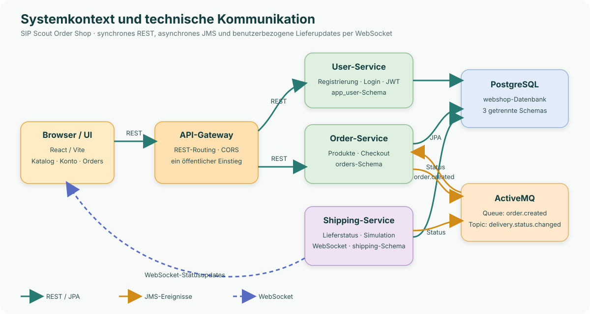
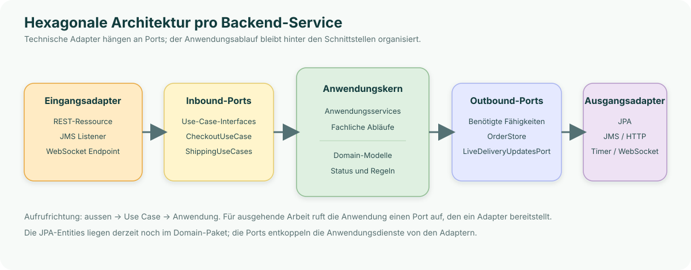

# Architektur und Bausteinsicht

## 1. Entwurfsziel

Der Shop soll als Jakarta-EE-Anwendung mehrere fachlich abgegrenzte Backend-Services betreiben. Der Browser erhält einen zentralen REST-Einstieg über das API-Gateway. Der Order-Service speichert Bestellungen und löst nach erfolgreicher Transaktion asynchron den Lieferprozess aus. Der Shipping-Service speichert Lieferungen und meldet Statusänderungen sowohl an den Order-Service als auch an die UI.

Die Lösung ist ein verteiltes Demo-System: Die Backend-Module können lokal einzeln gestartet und debuggt werden. Für den containerisierten Betrieb verbindet Docker Compose UI, Gateway, Services, PostgreSQL und ActiveMQ; nach der Architekturvorgabe wird nur der Edge-Gateway-Port am Host veröffentlicht.

## 2. Systemkontext und Lösungsansatz

*Abbildung 1: Systemkontext mit synchronem REST, asynchronem JMS, PostgreSQL und benutzerbezogenem WebSocket.*

Der Entwurf teilt die Verantwortungen nach fachlichen Fähigkeiten auf:

1. **User-Service:** Benutzerregistrierung, Anmeldung, Passwortprüfung, JWT-Erzeugung und eigenes Benutzerkonto.
2. **Order-Service:** Produktkatalog, Checkout, Bestand, Bestellungen und Übernahme von Lieferstatusereignissen.
3. **Shipping-Service:** Lieferdatensatz, Statussimulation, JMS-Veröffentlichung und WebSocket-Live-Updates.
4. **API-Gateway:** REST-Eingang, CORS und Weiterleitung der User-, Produkt- und Bestell-Requests.
5. **Webshop-UI:** Shop-Oberfläche, Tokenverwendung und Anzeige gespeicherter sowie live eintreffender Lieferzustände.

REST wird für Aufrufe verwendet, die eine unmittelbare Antwort benötigen. JMS entkoppelt die Bestellerstellung vom Lieferprozess. WebSocket ist ein zusätzlicher Live-Kanal; der dauerhaft gespeicherte Status wird beim erneuten Laden weiterhin über REST abgefragt.

## 3. Strukturperspektive: Bausteine und Abhängigkeiten

*Abbildung 2: Vereinfachte hexagonale Struktur der Backend-Module. Der konkrete Umfang der Adapter unterscheidet sich je Service.*

### 3.1 Paketstruktur

Die Backend-Module verwenden folgende Schichten:

| Paketbereich | Verantwortung | Beispiele aus dem Repository |
|---|---|---|
| `adapter/in` | Technische Eingänge; übersetzen REST-, JMS- oder WebSocket-Aufrufe in Anwendungsaufrufe | `OrderResource`, `AuthResource`, `OrderCreatedEventListener`, `ShippingStatusWebSocketEndpoint` |
| `application/port/in` | Von aussen aufrufbare Use Cases | `CheckoutUseCase`, `UserAccountUseCases`, `ShippingUseCases` |
| `application/service` | Orchestriert Anwendungsabläufe und Regeln | `CheckoutService`, `AuthService`, `ShippingService` |
| `application/port/out` | Benötigte Fähigkeiten ausserhalb der Anwendungsschicht | `OrderStore`, `TokenPort`, `DeliverySchedulerPort` |
| `adapter/out` | Technische Implementierungen der Ausgangs-Ports | JPA-Repositories, HTTP-Client, JMS-Publisher, Timer- und WebSocket-Adapter |
| `domain` | Fachliche Entitäten, Statuswerte und Ausnahmen | `OrderEntity`, `UserEntity`, `ShipmentEntity`, Status-Enums |

Abhängigkeitsrichtung: Ein Eingangsadapter ruft einen Inbound-Port auf. Der Anwendungsservice koordiniert den Ablauf und verwendet für Infrastrukturzugriffe Outbound-Ports. Die Adapter implementieren diese Ports. So bleiben REST, JPA, HTTP, JMS und Timer als technische Details an den Rändern organisiert.

**Bekannte Grenze des aktuellen Entwurfs:** Die JPA-Annotationen liegen teilweise direkt auf den Klassen im Paket `domain/model`. Damit ist das Domain-Modell nicht vollständig ORM-unabhängig; separate Persistenzmodelle sind nicht implementiert. Die Ports trennen die Anwendungsservices dennoch von den konkreten Repository-Adaptern.

### 3.2 Module und konkrete Adapter

| Modul | Eingänge / Inbound-Adapter | Anwendungs-Ports und Services | Ausgangs-Ports / Adapter |
|---|---|---|---|
| API-Gateway | `UserProxyResource`, `OrderProxyResource`, `ProductProxyResource`, `CorsFilter` | `GatewayRoutingUseCases`, `GatewayRoutingService` | `UserServicePort`, `OrderServicePort`, `ProductCatalogPort`; `HttpDownstreamAdapter` |
| User-Service | `AuthResource`, `UserResource`, JAX-RS-Exception-Mapper | `UserAccountUseCases`, `AuthService` | `UserStore`, `TokenPort`, `PasswordHashPort`; `JpaUserRepository`, `TokenService`, `PasswordEncoder` |
| Order-Service | `OrderResource`, `ProductResource`, `DeliveryStatusChangedListener` | `CheckoutUseCase`, `OrderUseCases`, `ProductCatalogUseCases`; Checkout-, Order- und Product-Service | `OrderStore`, `ProductStore`, `CurrentUserPort`, `OrderCreatedEventPort`; JPA-, Identitäts- und JMS/CDI-Adapter |
| Shipping-Service | `OrderCreatedEventListener`, `ShipmentResource`, `ShippingStatusWebSocketEndpoint` | `ShippingUseCases`, `ShippingService` | `ShipmentStore`, `CurrentUserPort`, `DeliveryStatusEventPort`, `LiveDeliveryUpdatesPort`, `DeliverySchedulerPort`; JPA-, Identitäts-, JMS-, WebSocket- und Timer-Adapter |

REST-Ressourcen sind technische Ein-Adapter. Die fachliche Anwendungslogik wird in den Use-Case-Services umgesetzt. Der API-Gateway besitzt keinen eigenen Produkt- oder Bestellbestand, sondern leitet diese Requests an den Order-Service weiter.

### 3.3 Datenhaltung und Integrationsgrenzen

Die Services verwenden dieselbe PostgreSQL-Datenbank `webshop`, aber getrennte Schemas: `app_user`, `orders` und `shipping`. Der Order-Service hält Produkt-, Order- und Order-Item-Daten. Schemaübergreifende IDs werden als UUID-Werte gespeichert, jedoch nicht durch Fremdschlüssel gekoppelt. Innerhalb des Order-Schemas existiert ein echter Fremdschlüssel von `order_item.order_id` auf `order.id`.

ActiveMQ vermittelt `order.created` als Queue und `delivery.status.changed` als Topic. Die UI kommuniziert für Live-Updates mit dem WebSocket-Endpunkt im Shipping-Service. Details zu Tabellen und Integritätsregeln stehen im [Datenmodell](datenmodell.md).

## 4. Technische Schnittstellen im Entwurf

| Richtung | Schnittstelle | Zweck |
|---|---|---|
| Browser → Gateway | REST unter `/api/*` | Öffentliche REST-Einstiegsstelle für UI-Aufrufe |
| Gateway → User-Service | HTTP REST | Registrierung, Login, Benutzerabfrage und Löschen des eigenen Kontos |
| Gateway → Order-Service | HTTP REST | Produktkatalog und Bestelloperationen |
| Order-Service → Shipping-Service | JMS Queue `order.created` | Nach erfolgreicher Speicherung einen Lieferauftrag übergeben |
| Shipping-Service → Order-Service | JMS Topic `delivery.status.changed` | Bestellung mit Lieferstatus aktualisieren |
| Browser → Shipping-Service | WebSocket `/ws/orders` | Laufende Statusänderungen zum angemeldeten Benutzer senden |
| Backend-Services → PostgreSQL | JPA/JDBC | Persistente Daten im jeweiligen Schema |

Die vollständigen Laufzeitabläufe, einschließlich Statusabbildung und Fehlerpfaden, beschreibt die [Laufzeit- und Interaktionssicht](laufzeit.md). Die übergreifenden Architekturentscheidungen und Verteilungsansichten sind zusätzlich in der [arc42-Dokumentation](../arc42.md) festgehalten.
