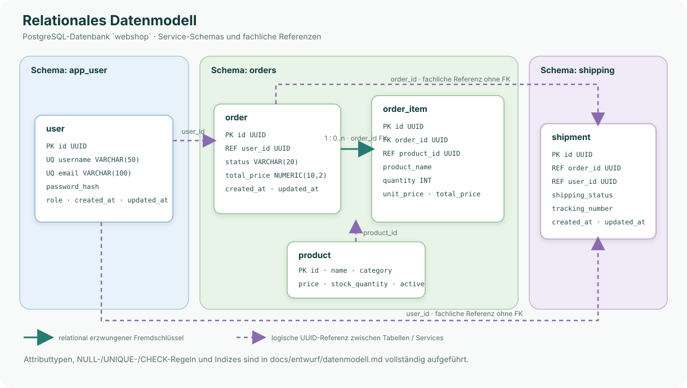

# Relationales Datenmodell

## Zweck und Quelle

Das Modell beschreibt das Datenbankschema `webshop` aus den eingecheckten Flyway-Migrationen. PostgreSQL wird von drei Services verwendet; jeder Service besitzt ein eigenes Schema. Die Datenbank hat echte Fremdschlüssel nur dort, wo sie in den Migrationen angelegt sind. Serviceübergreifende IDs sind fachliche UUID-Referenzen.

*Abbildung 1: Tabellen und Beziehungen. Der FK zwischen `orders.order` und `orders.order_item` ist relational erzwungen; gestrichelte Verbindungen zwischen Services sind logische Referenzen.*

## Tabellen und Attribute

### Schema `app_user` – User-Service

| Tabelle / Attribut | PostgreSQL-Typ | Regel / Bedeutung |
|---|---|---|
| `user.id` | UUID | Primärschlüssel, Default `gen_random_uuid()` |
| `user.username` | VARCHAR(50) | NOT NULL, UNIQUE |
| `user.email` | VARCHAR(100) | NOT NULL, UNIQUE |
| `user.password_hash` | VARCHAR(255) | NOT NULL; gespeichert wird der Hash, kein Klartextpasswort |
| `user.first_name` | VARCHAR(50) | NOT NULL |
| `user.last_name` | VARCHAR(50) | NOT NULL |
| `user.role` | `app_user.user_role` | NOT NULL, Default `CUSTOMER`; Werte `CUSTOMER`, `ADMIN` |
| `user.created_at` | TIMESTAMP | NOT NULL, Default `CURRENT_TIMESTAMP` |
| `user.updated_at` | TIMESTAMP | NULL erlaubt |

Indizes: `username`, `email`, `role`, `created_at DESC`. Username und E-Mail werden durch Unique Constraints eindeutig gehalten.

### Schema `orders` – Order-Service

#### `product`

| Attribut | PostgreSQL-Typ | Regel / Bedeutung |
|---|---|---|
| `id` | UUID | Primärschlüssel, Default `gen_random_uuid()` |
| `name` | VARCHAR(100) | NOT NULL |
| `description` | VARCHAR(500) | NULL erlaubt |
| `category` | VARCHAR(50) | NOT NULL; Check auf `WATER`, `SOFT_DRINKS`, `JUICE`, `BEER`, `COFFEE` |
| `price` | NUMERIC(10,2) | NOT NULL |
| `stock_quantity` | INT | NOT NULL, Default `0` |
| `active` | BOOLEAN | NOT NULL, Default `true` |
| `created_at` | TIMESTAMP | NOT NULL, Default `CURRENT_TIMESTAMP` |
| `updated_at` | TIMESTAMP | NULL erlaubt |

Indizes: `active`, `category`, `created_at DESC`.

#### `order`

| Attribut | PostgreSQL-Typ | Regel / Bedeutung |
|---|---|---|
| `id` | UUID | Primärschlüssel, Default `gen_random_uuid()` |
| `user_id` | UUID | NOT NULL; logische Referenz auf `app_user.user.id`, kein FK |
| `status` | VARCHAR(20) | NOT NULL, Default `CREATED`; Check auf `CREATED`, `CONFIRMED`, `SHIPPING`, `SHIPPED`, `DELIVERED`, `CANCELLED` (durch Migration V3 ergänzt) |
| `total_price` | NUMERIC(10,2) | NOT NULL, Default `0` |
| `created_at` | TIMESTAMP | NOT NULL, Default `CURRENT_TIMESTAMP` |
| `updated_at` | TIMESTAMP | NULL erlaubt |

Indizes: `user_id`, `status`, `created_at DESC`.

#### `order_item`

| Attribut | PostgreSQL-Typ | Regel / Bedeutung |
|---|---|---|
| `id` | UUID | Primärschlüssel, Default `gen_random_uuid()` |
| `order_id` | UUID | NOT NULL, echter FK auf `orders.order.id` |
| `product_id` | UUID | NOT NULL; logische Produktreferenz ohne FK |
| `product_name` | VARCHAR(100) | NOT NULL; beim Checkout gespeicherter Name |
| `quantity` | INT | NOT NULL; positive Menge wird im Anwendungscode geprüft |
| `unit_price` | NUMERIC(10,2) | NOT NULL; beim Checkout gespeicherter Einzelpreis |
| `total_price` | NUMERIC(10,2) | NOT NULL; gespeicherter Positionsbetrag |

Indizes: `order_id`, `product_id`. Die Produktbezeichnung und der Einzelpreis im Bestellposten sind Snapshots zum Bestellzeitpunkt; es gibt keine FK-Kaskade zu `product`.

### Schema `shipping` – Shipping-Service

#### `shipment`

| Attribut | PostgreSQL-Typ | Regel / Bedeutung |
|---|---|---|
| `id` | UUID | Primärschlüssel, Default `gen_random_uuid()` |
| `order_id` | UUID | NOT NULL; logische Referenz auf `orders.order.id`, kein FK |
| `user_id` | UUID | NOT NULL; logische Referenz auf `app_user.user.id`, kein FK |
| `shipping_status` | VARCHAR(30) | NOT NULL, Default `PREPARING`; Check auf `PREPARING`, `READY_FOR_SHIPMENT`, `SHIPPED`, `DELIVERED`, `CANCELLED` |
| `tracking_number` | VARCHAR(50) | NULL erlaubt |
| `created_at` | TIMESTAMP | NOT NULL, Default `CURRENT_TIMESTAMP` |
| `updated_at` | TIMESTAMP | NULL erlaubt |

Indizes: `order_id`, `user_id`, `shipping_status`, `created_at DESC`, `tracking_number`. Die Migration setzt weder eine FK- noch eine UNIQUE-Regel für `order_id`.

## Beziehungen und Integritätsgrenzen

| Beziehung | Kardinalität / Bedeutung | Durch Datenbank erzwungen? |
|---|---|---|
| `orders.order.id` → `orders.order_item.order_id` | Eine Order hat null oder mehr Items; ein Item gehört genau zu einer Order. Der Checkout verlangt mindestens ein Item. | Ja, FK vom Item zur Order; Mindestanzahl Items ist Anwendungsregel. |
| `app_user.user.id` → `orders.order.user_id` | Eine User-ID kann in mehreren Orders vorkommen. | Nein, fachliche Referenz über Service-/Token-Logik. |
| `orders.product.id` → `orders.order_item.product_id` | Ein Produkt kann in mehreren Bestellpositionen referenziert werden. | Nein, logische Referenz; Bestellname/-preis sind gespeichert. |
| `orders.order.id` → `shipping.shipment.order_id` | Ein Bestellereignis führt im Ablauf zur Anlage einer Shipment. | Nein, logische Referenz; keine FK- oder Unique-Bedingung in der Migration. |
| `app_user.user.id` → `shipping.shipment.user_id` | Eine User-ID kann mehreren Shipments zugeordnet sein. | Nein, fachliche Referenz für Besitzprüfung und WebSocket-Routing. |

Die getrennten Schemas vermeiden direkte Fremdschlüssel zwischen unabhängig deploybaren Services. Dafür müssen Service-Logik und JMS-Ereignisse die referenzierten IDs korrekt übergeben. Löschen und Aufbewahrung über Schema-Grenzen hinweg werden nicht durch Datenbankkaskaden geregelt.

## Invarianten: Datenbank und Anwendung

- **Datenbank-Constraints:** Primärschlüssel, User-Unique-Constraints, Order-Item-FK sowie die Enum-/Status-Checks aus den Migrationen.
- **Anwendungsregeln:** nichtleere Bestellung, positive Menge, ausreichender Bestand, Benutzerbesitz und zulässige Statusübergänge.
- **Nicht als DB-Regel vorhanden:** positive `price`, `stock_quantity >= 0`, eindeutiges `shipment.order_id` und serviceübergreifende Fremdschlüssel.

## Quelle im Repository

- `user-service/src/main/resources/db/migration/V1__Create_user_schema.sql`
- `order-service/src/main/resources/db/migration/V1__Create_orders_schema.sql`
- `order-service/src/main/resources/db/migration/V3__Add_delivered_order_status.sql`
- `shipping-service/src/main/resources/db/migration/V1__Create_shipping_schema.sql`
