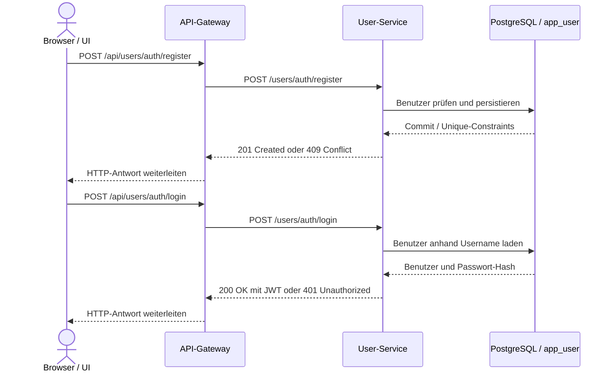

# Laufzeit- und Interaktionssicht

Diese Sicht zeigt, wie die Bausteine zur Laufzeit zusammenarbeiten. REST liefert synchrone Antworten. Die Lieferverarbeitung erfolgt danach asynchron über ActiveMQ. Die Statusdaten bleiben in PostgreSQL gespeichert; WebSocket liefert zusätzliche Live-Änderungen an eine angemeldete UI-Sitzung.

## 1. Registrierung und Anmeldung



Die Registrierung speichert den Passwort-Hash und nicht das Klartextpasswort. Beim Login prüft der User-Service die übermittelten Zugangsdaten und liefert ein JWT. Die UI sendet dieses Token bei geschützten REST-Aufrufen im `Authorization: Bearer …`-Header. Der Gateway routet den Request; die Service-Logik leitet die Benutzeridentität aus dem Token ab und prüft Besitzrechte.

## 2. Bestellung und simulierte Lieferung

```mermaid
sequenceDiagram
  actor B as Browser / UI
  participant G as API-Gateway
  participant O as Order-Service
  participant OD as PostgreSQL / orders
  participant Q as ActiveMQ / order.created
  participant S as Shipping-Service
  participant SD as PostgreSQL / shipping
  participant T as ActiveMQ / delivery.status.changed
  participant W as WebSocket /ws/orders
  B->>G: POST /api/orders + Bearer JWT
  G->>O: POST /api/orders + Authorization
  O->>O: Identität prüfen; Produkte, Menge und Bestand validieren
  O->>OD: Order, Items und Bestand in Transaktion speichern
  OD-->>O: Commit
  O-->>G: 201 Created mit Order-Daten
  G-->>B: 201 Created
  Note over O,Q: CDI-Event nach erfolgreichem Commit
  O-)Q: OrderCreated (orderId, userId, Items)
  Q-)S: Queue-Nachricht konsumieren
  S->>SD: Shipment anlegen
  S-)T: PREPARING
  S->>SD: Status READY_FOR_SHIPMENT und danach SHIPPED
  S-)T: READY_FOR_SHIPMENT und SHIPPED
  S->>S: One-shot-Timer mit zufälliger Verzögerung 1–10 Sekunden
  S-)W: Statusupdates für userId / orderId
  T-)O: Statusereignisse empfangen
  O->>OD: Bestellstatus fortschreiben
  W-->>B: ORDER_STATUS_CHANGED während die UI verbunden ist
  Note over S,SD: Nach Timerablauf
  S->>SD: Status DELIVERED speichern
  S-)T: DELIVERED
  S-)W: DELIVERED per WebSocket publizieren
  T-)O: DELIVERED empfangen
  O->>OD: Bestellstatus DELIVERED speichern
  W-->>B: Lieferung abgeschlossen
```

Die HTTP-Antwort `201 Created` bestätigt die gespeicherte Bestellung und kommt vor der asynchronen Zustellung. Ein Fehler beim Senden an JMS kann deshalb nach erfolgreicher Bestellspeicherung auftreten; der aktuelle Publisher protokolliert diesen Fehler, führt aber keinen Retry aus. Dies ist eine bekannte Robustheitsgrenze des Demo-Entwurfs.

## 3. Statusmodell und UI-Anzeige

| Lieferstatus (`shipping`) | Bestellstatus (`orders`) | Bedeutung |
|---|---|---|
| `PREPARING` | `CONFIRMED` | Lieferdatensatz wurde angelegt und der Auftrag bestätigt |
| `READY_FOR_SHIPMENT` | `SHIPPING` | Die Lieferung wird vorbereitet bzw. beginnt |
| `SHIPPED` | `SHIPPED` | Lieferung ist unterwegs; dieser Zustand folgt im aktuellen Demo-Ablauf unmittelbar auf `READY_FOR_SHIPMENT` |
| `DELIVERED` | `DELIVERED` | Timer ist abgelaufen und die Lieferung ist abgeschlossen |
| `CANCELLED` | `CANCELLED` | Lieferung bzw. Bestellung wurde abgebrochen |

Der Timer plant im aktuellen Code den Übergang von `SHIPPED` auf `DELIVERED` nach einer zufälligen Dauer von 1 bis 10 Sekunden. Die UI kann Statusnamen benutzerfreundlich darstellen, sollte aber die vom Backend gelieferten persistenten Bestelldaten als aktuellen Zustand behandeln.

Beim späteren Login lädt die UI Bestellungen erneut per REST und erhält damit auch Statusänderungen, die während einer geschlossenen Browser-Sitzung entstanden. WebSocket ist kein Ersatz für diesen Ladevorgang.

## 4. Datenbesitz und Autorisierung

- Die Order- und Shipment-Abfragen werden auf die aus dem Token ermittelte `userId` begrenzt.
- Die Bestellung enthält eine fachliche UUID-Referenz auf den Benutzer; zwischen `orders` und `app_user` existiert kein Datenbank-Fremdschlüssel.
- Das Shipment speichert `orderId` und `userId` als fachliche UUID-Referenzen ohne serviceübergreifende Fremdschlüssel.
- Nach dem WebSocket-Verbindungsaufbau authentifiziert sich die UI über eine Nachricht mit JWT. Der Shipping-Service ordnet anschliessende Updates der Benutzer-ID zu.
- Der Gateway ist der REST-Einstieg der UI. Im Compose-Produktionssetup transportiert der Edge-Gateway die WebSocket-Verbindung weiter zum Shipping-Service.

## 5. Fehler- und Alternativpfade

| Situation | Ergebnis im Ablauf |
|---|---|
| Username oder E-Mail bereits vergeben | User-Service weist Registrierung mit `409 Conflict` zurück; es wird kein zweites Konto gespeichert. |
| Ungültige Zugangsdaten | User-Service liefert `401 Unauthorized`; die UI erhält kein JWT. |
| Ungültiges/abgelaufenes Token oder fremde Ressource | Die geschützte Operation wird nicht für einen anderen Benutzer ausgeführt. |
| Ungültiges Produkt, Menge oder unzureichender Bestand | Checkout schlägt fehl; die Bestellung wird nicht als erfolgreich erstellt bestätigt. |
| Duplicate `OrderCreated`-Nachricht | Shipping-Service prüft eine bestehende Shipment zu `orderId` und ignoriert erkannte Duplikate. |
| JMS-Veröffentlichung nach Order-Commit schlägt fehl | Bestellung bleibt gespeichert; Fehler wird protokolliert. Der aktuelle Stand implementiert keine Wiederholung. |
| Browser ist bei Statusänderung offline | Status bleibt in PostgreSQL erhalten und wird beim nächsten REST-Abruf sichtbar; das Live-Ereignis ersetzt keine Persistenz. |

## 6. Verbindung zur Datenbanksicht

Die beschriebenen Zustände liegen servicebezogen in getrennten Schemas. Attribute, Schlüssel, Constraints, Indizes und die Abgrenzung echter Fremdschlüssel von fachlichen Referenzen stehen in der [Datenbankspezifikation](datenmodell.md).
